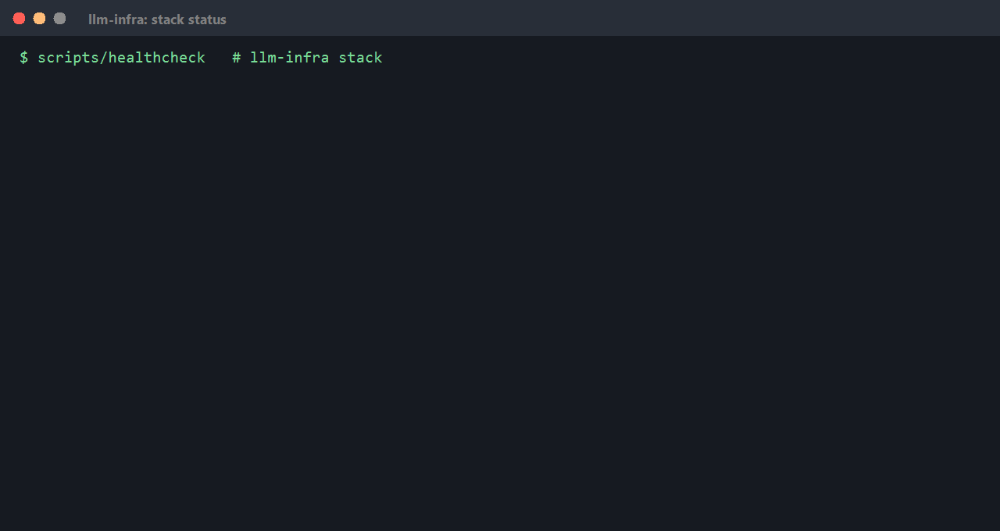
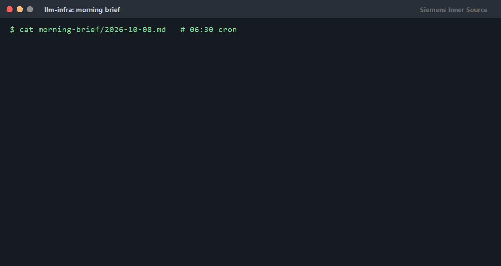

# llm-infra-setup

**Live-Demos (echte Terminal-Mitschnitte):**





## Architektur

```mermaid
flowchart LR
  agents["Agenten: opencode, Kollegen"] -->|"OpenAI-API"| litellm["LiteLLM Gateway, Port 4000"]
  humans["Menschen: Open WebUI, Port 3001"] --> litellm
  public["Oeffentlich: Azure-Gateway-VM, 443"] -->|"Reverse-Tunnel"| litellm
  litellm --> forwarder["vLLM-Weiterleiter, Port 30001"]
  forwarder --> runtime["vLLM-Laufzeit flash-next, Port 30000"]
  runtime --> gpu[("RTX PRO 6000 Blackwell")]
  runtime -.->|"vLLM-Metriken"| prom["Prometheus, Port 9090"]
  podman["Container-Protokolle"] --> alloy["Alloy"]
  alloy --> loki["Loki, Port 3100"]
  prom --> grafana["Grafana, Port 3000"]
  loki --> grafana
  facts["collect-host-facts, 30s Timer"] -->|"Textfile"| prom
  brief["morning-brief, 06:30 Cron"] -->|"Markdown"| home["Homepage"]
```bash
./setup.sh          # richtet alles ein; bei Bedarf mehrfach ausfuehren
./scripts/doctor.sh # zeigt, was nicht passt, und nennt den passenden Befehl
```

`./setup.sh` bricht nicht mit einer kryptischen Meldung ab, sondern sagt am Ende,
was noch offen ist. Nach einem Abbruch (Netzwerk, Neustart, abgesteckte GPU)
einfach denselben Befehl erneut ausfuehren - Fertiges wird erkannt und
uebersprungen.

## Schnellstart von Hand

```bash
cp config/host.env.example config/host.env
make preflight            # Host-Zustand erfassen
make validate             # Repo-Pruefung
make install              # Pakete (braucht sudo)
make zfs                  # Dataset anlegen; vorhandene Pools bleiben unangetastet
make nvidia-driver        # Treiber; danach Neustart und erneut ./setup.sh
make podman               # rootless Podman, CDI, GPU-Test
make model                # Modell laden (fortsetzbar)
make pennyroyal           # Bild ziehen, Runtime-Unit erzeugen
make ple-nvme             # SSD-Auslagerung der Einbettungen vorbereiten
make deploy-non-gpu       # Portal, Chat, Gateway, Beobachtung (ohne GPU)
make deploy-ready         # kompletter Stack, wenn die GPU da ist
make healthcheck
```

`make` ohne Argument zeigt alle Befehle mit Erklaerung.

## Was dann laeuft

Der Einstieg fuer den Menschen ist benanntes HTTPS ueber den lokalen Caddy
(ausschliesslich Loopback, Host `127.0.0.1:443`): `https://homepage.localhost`
fuer das Portal und `https://grafana.localhost/grafana/` fuer die Dashboards.
Zertifikat ist Caddys eigene lokale CA; einmal verankern mit
`./scripts/74-setup-local-proxy.sh --ca-import`.

Alle Dienstports bleiben auf `127.0.0.1` (Ausnahme: der freigegebene oeffentliche
443-Pfad ueber den Azure-Tunnel, siehe `docs/gateway-proxy.md`).

| Adresse | Dienst | Wofuer |
|---|---|---|
| https://homepage.localhost | Homepage | Einstiegseite fuer den Betreiber |
| https://grafana.localhost/grafana/ | Grafana | Dashboards, ohne Anmeldung lesbar |
| http://127.0.0.1:3001 | Open WebUI | Chat, Dateien, RAG |
| http://127.0.0.1:3002 | Homepage | Portal direkt (ohne Proxy, nur Diagnose) |
| http://127.0.0.1:3000 | Grafana | Grafana direkt (ohne Proxy, nur Diagnose) |
| http://127.0.0.1:3003 | Wiki | Anleitung und Handbuch |
| http://127.0.0.1:4000 | LiteLLM | ein Gateway, ein Schluessel |
| http://127.0.0.1:30000 | vLLM-Laufzeit | Modell direkt (nur Diagnose) |
| http://127.0.0.1:30001 | vLLM-Weiterleiter | Uebersetzung fuer den Gateway |
| http://127.0.0.1:9090 | Prometheus | Metriken und Alarmregeln |
| http://127.0.0.1:9093 | Alertmanager | Alarme, bewusst ohne Empfaenger |
| http://127.0.0.1:8080 | Dozzle | Live-Protokolle |

Zugangsdaten werden bei der ersten Einrichtung erzeugt und liegen **nicht** im
Repository, sondern unter `~/.config/llm-infra/` (Modus 0600) und als
Podman-Secret:

```bash
./scripts/show-credentials.sh
```

## Geschwindigkeit

Die Zahlen unten sind ein Stand vom 2026-10-02 mit Pennyroyal v2.5.3; seitdem
laeuft auf diesem Rechner die vLLM-Laufzeit `flash-next` (Gemessenes: `make
benchmark` bzw. `./scripts/benchmark.sh`, eingeordnet in `docs/performance.md`).
Gemessen am 2026-10-02 mit Pennyroyal v2.5.3: 157,88 Token/s bei einem normalen
Prompt, 119,01 Token/s bei langem Prompt, 242 Token/s insgesamt bei vier
gleichzeitigen Anfragen. Die Einzelanfrage bleibt bei etwa 160 Token/s stehen,
weil die externe Grafikkarte ueber Thunderbolt nur vier PCIe-Leitungen bei
16 GT/s aushandelt (moeglich waren 16 Leitungen bei 32 GT/s). Die GPU ist dabei
nur zu 61 % ausgelastet - sie wartet auf Daten, nicht auf Rechenzeit.

```bash
./scripts/benchmark.sh normal 4     # messen
cat docs/performance.md             # Einordnung und Hebel
```

## Arbeitsstand sichern (das Repository ist das Backup)

```bash
make checkpoint      # pruefen, committen, pushen - nach jedem abgeschlossenen Schritt
make ungesichert     # zeigen, was noch nicht gesichert ist
```

Der Fortsetzungsanker ist `docs/HANDOFF.md`: was gerade gilt, was offen ist, welche
Befehle der naechste Leser braucht. Nach einem Abbruch zuerst dort nachlesen.

## Grundregel: die Grafikkarte gehoert dem Modell

Kein zweiter Container, keine VM und kein Trainingslauf bekommt GPU-Zugriff; die
Inferenz nutzt einen Kern (TP1). Begründung: `docs/adr/0013-*.md`.

## Wichtige Dateien

```
setup.sh                     Einstieg von Hand
scripts/doctor.sh            Diagnose mit naechsten Befehlen
scripts/*.sh                 ein Schritt pro Datei, nummeriert, alle wiederholbar
lib/common.sh                Protokoll, Wiederholungen, Geheimnis-Helfer
lib/units.sh                 eine Quadlet-Installationsregel fuer alle Pfade
lib/secrets.sh               Zugangsdaten ausserhalb von Git
quadlet/                     Dienste (teilweise generiert, Header sagt es)
config/                      Vorlagen; generierte Dateien haben einen Header
systemd/                     Timer: Host-Kennzahlen, Runtime-Waechter
state/                       Laufzeitstaende, Protokolle, Messungen (nicht in Git)
versions.lock                gepinnte Versionen (Hoststand: state/host-facts.txt)
docs/                        Doku; mkdocs serve
```

## Sicherheit in einem Absatz

Alle Dienste binden an `127.0.0.1`, laufen rootless, Modellgewichte sind
read-only einghaengt, Passwoerter sind Zufallswerte ausserhalb von Git, und
`make validate` prueft auf Muster wie `hf_…`, `sk-…` und private Schluessel.
Der einzige bewusste Kompromiss ist das Seccomp-Profil des Inferenz-Containers
(io_uring fuer den SSD-Vorleser). Details und offene Aufgaben: `docs/security.md`.

## Doku

```bash
make docs        # lokal unter http://127.0.0.1:8000
```

Architektur, Betrieb, Fehlerbilder, Sicherheit, Geschwindigkeit,
Sicherung/Rueckgabe und 13 Entscheidungsprotokolle (ADRs) unter `docs/`.
